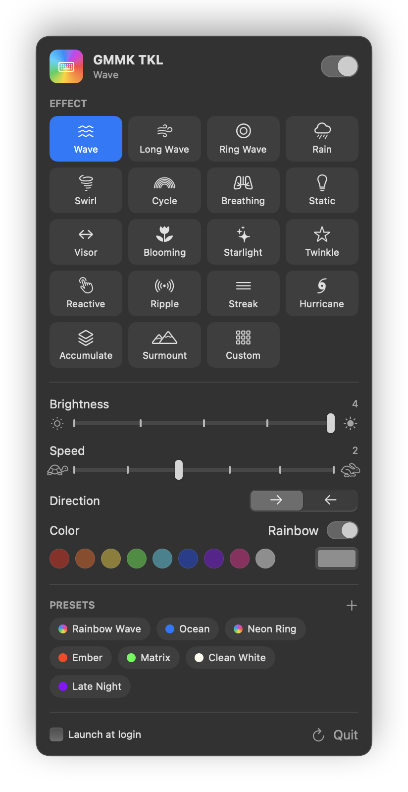
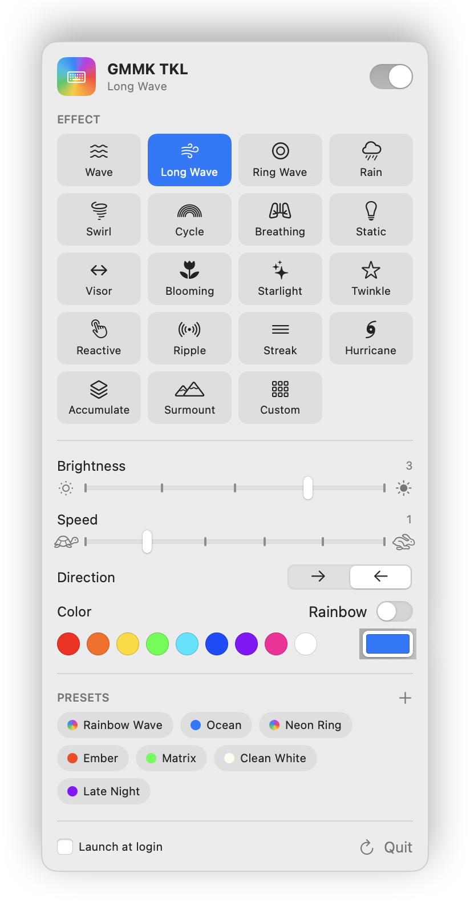
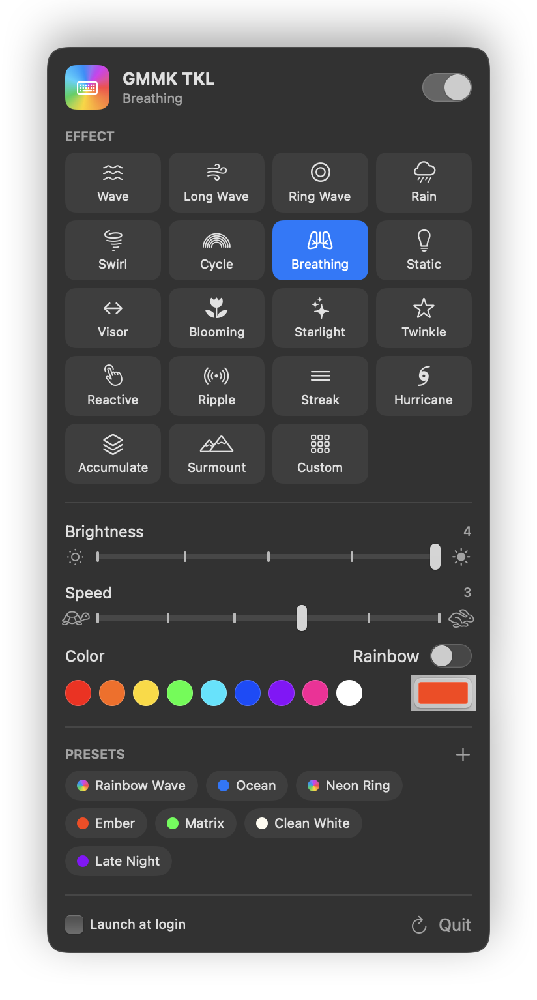

<p align="center">
  
</p>

# GMMK Lights

A small macOS menu bar app for controlling the RGB lighting on a **first-generation GMMK TKL keyboard** (SONiX/EVision controller, USB ID `0C45:652F`).

<p align="center">
  
  
  
</p>
<p align="center"><sub>Rainbow wave · single-color wave in light mode · breathing effect</sub></p>

> **Disclaimer:** This is an independent, unofficial hobby project. It is **not affiliated with, endorsed by, or supported by Glorious LLC** or any of its partners. "Glorious" and "GMMK" are trademarks of their respective owners and are used here only to describe which hardware this app works with. Use at your own risk.

---

## Why this exists

The official keyboard software for the original GMMK is **Windows-only**, so on a Mac there was no way to change the lighting except with Fn key combos, and no way to see what the keyboard was actually set to.

This project started as a troubleshooting session: the keyboard's LEDs looked completely dead. Instead of guessing, we talked to the keyboard over USB from the Mac and read its settings. The cause turned out to be simple: **brightness was set to 0**. Once the keyboard was talking to the Mac, a proper app was the obvious next step.

## Features

- **19 lighting effects**: Wave, Long Wave, Ring Wave, Rain, Swirl, Spectrum Cycle, Breathing, Static, Visor, Blooming, Starlight, Twinkle, Reactive, Ripple, Streak, Hurricane, Accumulate, Surmount and the keyboard's stored Custom layout
- **Brightness** (0–4) and an on/off switch that remembers your last brightness
- **Speed** and **direction** controls (direction only appears for effects that use it)
- **Color**: a full rainbow, one-click swatches, or any color from the macOS color picker
- **Presets**: six built in (Rainbow Wave, Ocean, Neon Ring, Ember, Matrix, Clean White), plus your own (save with **+**, delete by right-clicking)
- **Reads the keyboard's settings** when it connects, so the app always matches the hardware
- **Hot-plug**: reconnects when you unplug and replug the keyboard
- **Launch at login**
- Native Swift/SwiftUI, with **no dependencies**: no drivers, no kernel extensions, no Python, no Homebrew

## Requirements

- macOS 14 (Sonoma) or newer
- Xcode or the Xcode Command Line Tools (Swift 5.9+) to build
- A GMMK TKL (1st gen) using the stock firmware: USB vendor `0x0C45`, product `0x652F`

Other keyboards built on the same EVision controller will probably work too, but haven't been tested.

## Build & install

```sh
./build.sh            # builds "build/GMMK Lights.app"
./build.sh --install  # builds and copies it to /Applications
```

Then open **GMMK Lights** and click the keyboard icon in the menu bar.

### Input Monitoring permission

The keyboard's lighting controls share a USB interface with its typing keys, so macOS treats the app like something that reads keyboard input and may ask for **Input Monitoring** access. The app only sends lighting commands and never reads your keystrokes. If it shows *Permission needed*:

1. Click **Open Privacy Settings**.
2. Enable **GMMK Lights**.
3. Quit and reopen the app.

The app is signed locally (ad-hoc), so macOS may ask again after each rebuild.

## How it works

The keyboard exposes a vendor-specific HID interface (usage page `0xFF1C`). Lighting is controlled with 64-byte reports:

| Byte  | Meaning |
|-------|---------|
| 0     | Report ID `0x04` |
| 1–2   | 16-bit checksum (little-endian sum of bytes 3–63) |
| 3     | Command |
| 4     | Data length |
| 5–6   | Offset in the config block (little-endian) |
| 7     | Status in replies (0 = OK) |
| 8–63  | Data |

The commands used are `0x01` begin, `0x02` end, `0x05` read config and `0x06` set parameter. Lighting lives in the first 8 bytes of the config block: **mode, brightness, speed, direction, rainbow flag, R, G, B**.

The app opens the device in **non-exclusive** mode, so the keyboard keeps typing normally while the app talks to it.

### Safety

- The app **never touches firmware**. It only reads and writes the lighting settings that the keyboard's own Fn shortcuts change.
- Nothing is flashed, and no bootloader commands are sent.
- **Don't flash QMK onto this keyboard.** Glorious's public QMK fork doesn't include a target for the 1st-gen GMMK TKL, and flashing the wrong firmware can leave the keyboard unusable.

If the lights ever look dead, check the brightness first (Fn + ↑, or the brightness slider in the app).

## Project layout

```
GMMKBar/
├── Package.swift
├── docs/                        # README banner and screenshots
├── build.sh                     # builds and bundles the .app (ad-hoc signed)
└── Sources/GMMKBar/
    ├── GMMKDevice.swift         # IOKit HID transport and the EVision protocol
    ├── Model.swift              # effects, presets, app state, launch at login
    ├── App.swift                # SwiftUI menu bar interface
    └── Screenshots.swift        # renders the README screenshots offline
```

To regenerate the screenshots (no keyboard needed):

```sh
swift build -c release && .build/release/GMMKBar --screenshots "$PWD/docs"
```

## Ideas / roadmap

- Per-key custom colors
- Switching between the keyboard's three onboard profiles
- Screen-sync and audio-reactive modes
- A proper app icon

## Credits

- **[OpenRGB](https://github.com/calcprogrammer1/openrgb)**: its EVision keyboard controllers documented the packet format and commands.
- **[GmmkUtil](https://github.com/Kolossi/GmmkUtil)**: an earlier open-source C# tool that confirmed the USB interface and packet layout for this keyboard family.

## License

[MIT](LICENSE), provided as-is with no warranty. You use this software at your own risk, including any changes it makes to your keyboard's settings.

OpenRGB is GPL-2.0-or-later. This app re-implements the protocol independently and contains no OpenRGB code. "Glorious" and "GMMK" are trademarks of their respective owners. The MIT license covers this project's code only and grants no rights to those trademarks.
